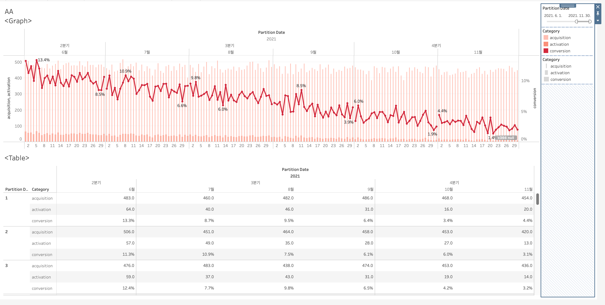
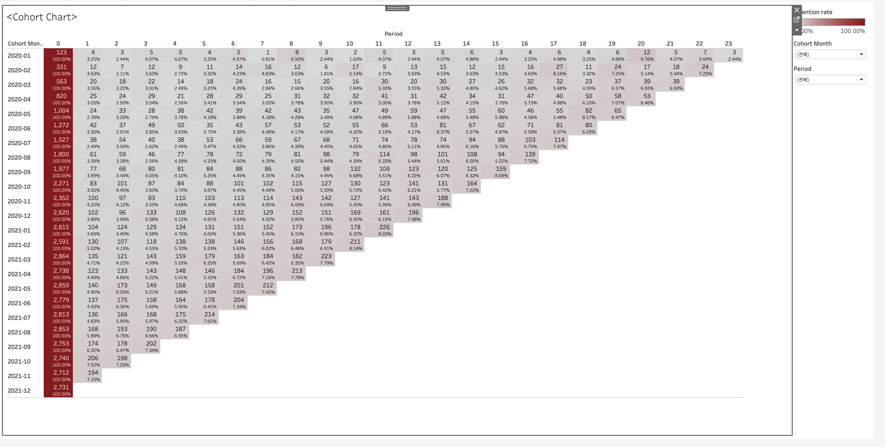

# 금융 서비스 데이터 분석 프로젝트

핀테크(대출·결제·보험) 서비스 데이터로 **퍼널 병목 진단 → A/B 테스트 검증 → 리텐션과 성장 한계 추정 → 전환 요인 해석 → 지표 모니터링 대시보드**까지, 제품 지표 분석의 전 과정을 수행한 프로젝트입니다.

> 메타코드 금융데이터분석 부트캠프 실습 데이터를 사용했습니다. 원본 데이터는 강의 자료이므로 저장소에 포함하지 않았습니다.

**사용 도구**: Python (pandas, SciPy, XGBoost, SHAP, seaborn) · Tableau


---

## 주요 결과 요약

| 분석 | 핵심 결과 |
|---|---|
| 대출 퍼널 + A/B 테스트 | 신분증 인증 단계 병목 발견 → 개선 화면 적용 시 다음 단계 도달률 **34.6% → 51.9% (상대 +50.3%)**, χ² ≈ 476.8, p < 0.001 |
| 코호트 + Carrying Capacity | 주 평균 신규 유입 230명, 첫 주 리텐션 48.5% → 제품이 유지할 수 있는 활성 사용자 한계 **약 447명** |
| 보험 가입 요인 분석 | 브릿지(혜택성) > 혜택 > 상세(정보성) 지면 순으로 기여, 혜택성 지면은 효과 체감이 뚜렷함 |
| 지표 대시보드 | 2021년 6~11월 전환율이 약 13% → 약 3%로 하락하는 추세 확인 |

---

## 1. 대출 퍼널 분석 및 A/B 테스트 — `analysis/A_B_test.ipynb`

**퍼널 분석**
대출 신청 6단계(본인인증 → 신분증 인증 → 개인정보 입력 → 대출 조건 → 대출 심사 → 대출 실행)를 사용자 1만 명 기준으로 분석했습니다.

| 단계 | 사용자 수 | 최초 대비 전환율 |
|---|---|---|
| A. 본인인증 | 10,000 | 100.0% |
| B. 신분증 인증 | 8,024 | 80.2% |
| C. 개인정보 입력 | 2,482 | 24.8% |
| D. 대출 조건 | 2,213 | 22.1% |
| E. 대출 심사 | 1,762 | 17.6% |
| F. 대출 실행 | 1,218 | 12.2% |

신분증 인증(B)에서 개인정보 입력(C)으로 넘어가는 구간에서 가장 큰 이탈이 발생했습니다.

**가설 및 실험 설계**
- 가설: 제휴사의 신분증 촬영·인식 솔루션 결함이 이탈 원인
- 실험군: 개선된 화면 노출 / 대조군: 기존 화면 노출
- 평가 지표: B 단계 도달 사용자 중 C 단계 도달률

**결과**
- C 단계 도달률: 실험군 **51.93%**, 대조군 **34.56%** (상대 개선율 50.27%)
- 카이제곱 독립성 검정: χ² = 476.8, 자유도 1, p ≈ 1.06e-105 → 개선 효과가 통계적으로 유의함

---

## 2. 코호트 리텐션 및 Carrying Capacity — `analysis/CC&AAR.ipynb`

> 파일명의 **CC는 Carrying Capacity**(제품이 장기적으로 유지할 수 있는 사용자 규모)를 뜻합니다.

- 결제 데이터를 사용자별 첫 거래 주차 기준으로 묶어 **주간 코호트 리텐션 히트맵**을 작성했습니다.
- 첫 거래 후 1주차 리텐션은 48.5%이며, 이후 완만하게 평탄화됩니다. 따라서 첫 주 리텐션을 대표값으로 사용했습니다.
- **Carrying Capacity = 주 평균 신규 유입 ÷ (1 − 리텐션) = 230.1 ÷ (1 − 0.485) ≈ 447명**
- 즉, 현재 유입과 리텐션이 유지되면 활성 사용자는 약 447명 수준에서 더 늘지 않습니다. 성장하려면 유입 확대보다 리텐션 개선이 효과적이라는 시사점을 얻었습니다.

---

## 3. 보험 가입 요인 분석 (XGBoost + SHAP) — `analysis/ML.ipynb`

**데이터**
보험 플랫폼의 일별 지면 방문자 수 5개를 설명변수로, 보험 가입 지면 방문자 수를 종속변수로 사용했습니다.

| 변수 | 지면 성격 |
|---|---|
| `bnft_user_cnt` | 행동 기반 리워드 지급 (혜택성) |
| `lck_comp_user_cnt` | 가입 보험 가성비 평가 |
| `bridge_user_cnt` | 외부 마케팅 랜딩 → 보험 가입 연결 (혜택성) |
| `detail_user_cnt` | 보험료·보장내역 조회 (정보성) |
| `r_fee_user_cnt` | 보험금 간편 청구 |

**방법**
XGBoost Random Forest 회귀 모델을 학습하고, SHAP으로 변수 기여도를 해석했습니다. 사용한 SHAP 시각화는 summary, dependence, waterfall plot입니다.

**결과**
- 기여도 순위: 브릿지(혜택성) > 혜택(혜택성) > 상세(정보성)
- 모든 지면 방문이 보험 가입과 양(+)의 관계를 보였습니다.
- 혜택성 지면은 방문이 늘수록 효과가 빠르게 체감했고, 정보성 지면은 체감이 덜했습니다. 따라서 **정보성 지면을 전면에 배치하는 것이 효율적**이라고 판단했습니다.
- 가입이 가장 많았던 날과 가장 적었던 날을 waterfall plot으로 비교해 일별 성과 차이의 원인을 분해했습니다.

> 이 분석은 예측 성능보다 **요인 해석(설명)**에 초점을 두었습니다. 별도의 학습/검증 분할 및 성능 평가는 수행하지 않았습니다.

---

## 4. 지표 모니터링 대시보드 (Tableau)

**전처리** — `analysis/tableau_dashboards/preprocessing.ipynb`
- 가입·거래 데이터의 날짜 형식을 변환하고, 거래 이력이 없는 사용자를 분리했습니다.
- 일별 Acquisition(신규 가입), Activation(첫 거래 발생), Conversion(Activation ÷ Acquisition)을 계산했습니다.
- 계산 결과를 Tableau에서 쓰기 좋은 스택(long) 형태로 변환했습니다.
- 월별 코호트 테이블도 함께 생성해 `acq_act.csv`, `cohort.csv`로 저장했습니다.

**대시보드** — `dashboards/AAR.twbx`

| AA 대시보드 (Acquisition·Activation·Conversion) | 코호트 리텐션 차트 |
|---|---|
|  |  |

- 기간 필터로 일별 지표 추이를 확인할 수 있습니다. 2021년 6월 약 13%였던 전환율이 11월 약 3%까지 하락했습니다.
- 코호트 차트는 2020년 1월부터 2021년 12월까지의 월별 리텐션을 보여줍니다.

---

## 디렉토리 구조

```
financial/
├── analysis/
│   ├── A_B_test.ipynb            # 대출 퍼널 분석 + A/B 테스트
│   ├── CC&AAR.ipynb              # 주간 코호트 리텐션 + Carrying Capacity
│   ├── ML.ipynb                  # XGBoost + SHAP 보험 가입 요인 분석
│   └── tableau_dashboards/
│       ├── preprocessing.ipynb   # 대시보드용 지표 산출 및 변환
│       ├── acq_act.csv / .xlsx   # 일별 Acquisition·Activation·Conversion
│       └── cohort.csv / .xlsx    # 월별 코호트 테이블
└── dashboards/
    ├── AAR.twbx                  # Tableau 패키지 워크북
    ├── screenshot_dashboard_AA.png
    └── screenshot_dashboard_R.png
```

## 실행 방법

1. 원본 데이터는 저장소에 포함되어 있지 않습니다. 노트북은 분석 과정과 출력 결과를 확인하는 용도입니다.
2. `.twbx` 파일은 Tableau Desktop 또는 Tableau Reader에서 열 수 있습니다.

## License

MIT

## 연락처

jjykaya0225@naver.com
